# Blokk — Pebble Time, Time Round, Time 2 & Round 2

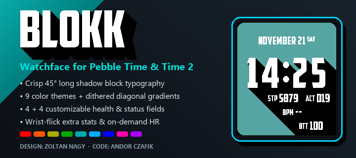

A native C port of the original Fitbit **Blokk** watchface (Design: **Zoltan Nagy / Zo Nagy**, Code: **Andor Czafik**) for **Pebble Time (`basalt`, 144×168)**, **Pebble Time Round (`chalk`, 180×180 round)**, **Pebble Time 2 (`emery`, 200×228)** and **Pebble Round 2 (`gabbro`, 260×260 round)**.

It preserves the iconic bold condensed typography (`American Captain`), mathematically exact 45° black long drop shadows, 9 vibrant color themes with optional diagonal gradients, date header, and the 4 staggered health & status fields nested cleanly inside the shadow zone.

**Download latest release:** [Blokk-1.1.1.pbw](https://github.com/czandor/Blokk-Clockface-Pebble/releases/latest) (also in `dist/Blokk-1.1.1.pbw` with `dist/SHA256SUMS.txt`)

## Features

- **Bold Block Typography & 45° Long Shadows:** Huge centered `HH:MM` digits (and optional bottom-left `AM`/`PM` in 12h mode) cast a razor-sharp 45° solid black shadow down and right across the screen, computed directly on the framebuffer with zero shadow bitmap overhead.
- **9 Color Themes & Diagonal Gradients:**
  - Colors: Red, Orange, Yellow, Green, Turquoise, Blue, Dark Blue, Pink, Purple.
  - 6 selection modes: *By the time of day* (default), *Choose one color*, *Random every day*, *Random every hour*, *Random every minute*, and *Random on wrist flick*.
  - Optional **Gradient background** rendered with 4×4 Bayer ordered dithering on Pebble Time 2's 64-color display.
- **4 Configurable Info Fields (plus 4 Extra Fields on Wrist Flick):**
  - Choose from: `STP` (Steps), `BPM` (Heart rate, Pebble Time 2 only), `BTT` (Battery % or low-battery only ≤30%, with a trailing `+` while on the charger), `DST` (Distance in km or miles), `CAL` (Calories burned), `ACT` (Active minutes), `SLP` (Sleep hours), `SEC` (Seconds), `VIB` (`ON`, or `OFF` while Quiet Time is active — the default top-right field), or `Nothing`.
  - Automatically switches between `MINUTE_UNIT` and `SECOND_UNIT` tick timers depending on whether `SEC` is currently visible.
  - Enable **Extra Info Fields** to toggle a second set of 4 fields for 20 seconds by flicking your wrist (with optional short vibration respecting Quiet Time).
- **Round Display Layouts (Pebble Time Round & Round 2):** Digits and fields arranged for the 180×180 and 260×260 circles; the shadow and background are drawn only inside the visible round area.
- **Offline Clay Settings:** Configure everything directly in the Pebble phone app without requiring internet access (via the maintained `@rebble/clay` package).

## Screenshots

| Pebble Time 2 (Turquoise) | Pebble Time 2 (Gradient) | Pebble Time 2 (12h AM) | Pebble Time 2 (12h PM) | Pebble Time (Red) |
| :---: | :---: | :---: | :---: | :---: |
| 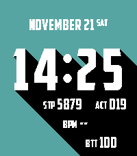 | 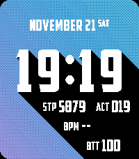 | 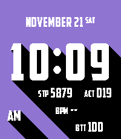 | 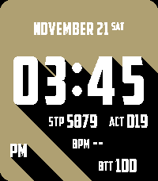 | 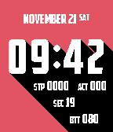 |

| Pebble Round 2 (Turquoise) | Pebble Round 2 (Gradient) | Pebble Round 2 (12h AM) | Pebble Time Round (Turquoise) | Pebble Time Round (Purple) |
| :---: | :---: | :---: | :---: | :---: |
| 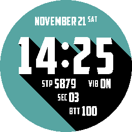 | 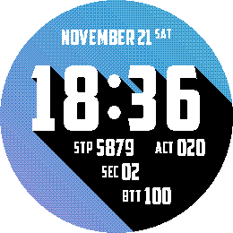 | 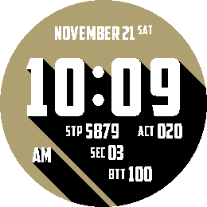 | 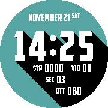 | 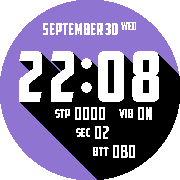 |

## Repository Structure

| Path | Contents |
| --- | --- |
| `pebble/` | Native Pebble C source (`src/c/main.c`), PebbleKit JS (`src/pkjs/`), offline Clay configuration, and `AmericanCaptain.ttf` font. |
| `dist/` | Compiled `Blokk-*.pbw` builds and `SHA256SUMS.txt`. |
| `tools/` | Build scripts (`build.ps1`, `build.sh`), manifest/config generator (`prepare-project.cjs`), emulator control panel (`Emulator-vezerlo.cmd`), and unit tests (`test.cjs`). |
| `docs/` | Developer handoff (`FEJLESZTES.md`), changelog (`VALTOZASOK.md`), validation notes (`VALIDATION.md`), and emulator screenshots. |
| `original/` | Read-only Fitbit Blokk reference source, screenshots, and font archive. |

## Building & Testing

On Windows (using the shared WSL `NineTimeSDK` environment):

```powershell
powershell -ExecutionPolicy Bypass -File tools/build.ps1
node tools/test.cjs
```

## Support

This watchface is completely free. If you enjoy it and would like to support our work:

[☕ Buy us a coffee](https://czandor.hu/paypal/blokk)
